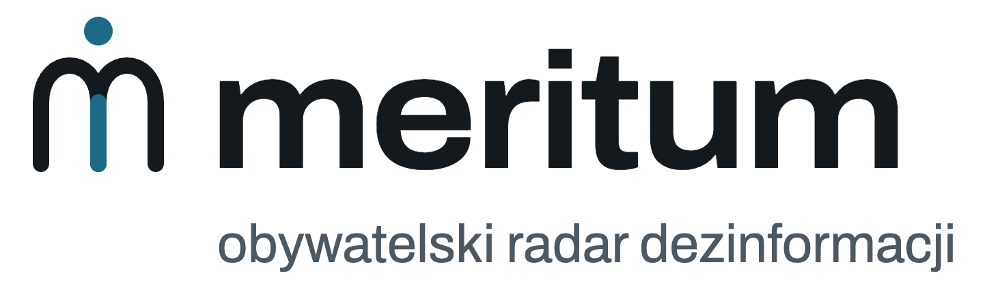
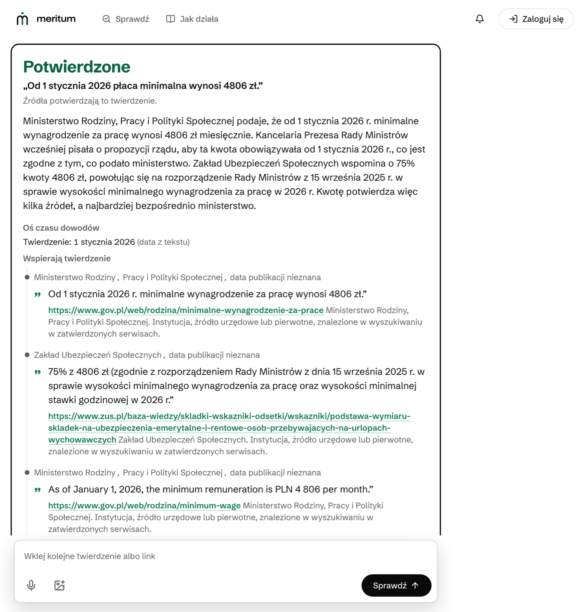

  <picture>
    <source media="(prefers-color-scheme: dark)" srcset="meritum-logo-dark.png">
    <source media="(prefers-color-scheme: light)" srcset="meritum-logo-light.png">
    
  </picture>

Meritum pomaga sprawdzić pogłoskę albo informację z sieci. Wklejasz tekst lub link i dostajesz ocenę każdego twierdzenia razem z cytatami ze źródeł, na których się opiera. Narzędzie jest dla każdego obywatela, także dla osób o niskich kompetencjach cyfrowych.

To prototyp przygotowany na hackathon HackNation 2026 w konkursie MSZ „Prawdowid”.

  <picture>
    <source media="(prefers-color-scheme: dark)" srcset="wynik-sprawdzenia-dark.png">
    <source media="(prefers-color-scheme: light)" srcset="wynik-sprawdzenia-light.png">
    
  </picture>
   
  Wynik sprawdzenia w środowisku dev, 22 listopada 2026. Wygląd strony jest w trakcie odświeżania.

## Po co

Pogłoska trafia do człowieka w feedzie albo w wiadomości od znajomych. Sprostowanie często już istnieje, tylko gdzie indziej: w serwisie fact-checkingowym, w komunikacie urzędu, w akcie prawnym. Czat AI odpowie płynnie i pewnie, ale odpowiedzi bez źródła nie da się sprawdzić.

## Jak działa sprawdzenie

1. Wysyłasz tekst, link, nagranie głosowe albo zrzut ekranu. Konto nie jest potrzebne.
2. System wyodrębnia twierdzenia, które da się sprawdzić, i oddziela je od opinii.
3. Szuka dowodów w jawnym katalogu źródeł, w którym są serwisy urzędowe i instytucje, oraz wśród ocen fact-checkerów z Google Fact Check Tools API. W sieci szuka tylko w domenach z katalogu.
4. Każde twierdzenie dostaje jeden z pięciu werdyktów: potwierdzone, fałszywe, wprowadzające w błąd, brak wystarczających dowodów albo nie podlega weryfikacji.
5. Pod werdyktem są cytaty z wydawcą, datą i linkiem. Cytat, którego nie ma dosłownie w tekście źródła, system odrzuca.

Obok werdyktu jest siła podstawy. Wynika z jawnych przesłanek: ile niezależnych źródeł potwierdza twierdzenie, ile z nich jest urzędowych, czy są aktualne i zgodne. Gdy dowodów brakuje, Meritum nie rozstrzyga i mówi, czego nie udało się ustalić.

AI pomaga zrozumieć pytanie, przeszukać materiały i napisać odpowiedź prostym językiem. Werdykt wynika z cytatów i przesłanek, które każdy może sprawdzić sam.

Sprawę nierozstrzygniętą albo sporną można przekazać moderatorom. Polecenia ukryte w sprawdzanej treści system ignoruje i zapisuje jako zdarzenie. Każde sprawdzenie zostawia zapis przebiegu z zamaskowanymi danymi osobowymi, usuwany po 30 dniach.

## Co można wypróbować

| Co | Adres |
|---|---|
| Aplikacja webowa | [meritum.gburek.app](https://meritum.gburek.app) |
| Makieta Discorda, bez konta | [meritum-discord.gburek.app](https://meritum-discord.gburek.app) |
| Aplikacja Discord z komendą `/sprawdz` | [zainstaluj „Meritum”](https://discord.com/oauth2/authorize?client_id=1573692006398693396) |
| Dokumentacja API | [meritum.gburek.app/api/docs](https://meritum.gburek.app/api/docs) |
| Wersja rozwojowa aplikacji | [meritum-dev.gburek.app](https://meritum-dev.gburek.app) |

Jest też wtyczka do przeglądarki, która dodaje przycisk „Sprawdź” pod postami. Do jej pokazu służą makiety platform z fikcyjnymi danymi: [X](https://meritum-x.gburek.app), [Facebook](https://meritum-facebook.gburek.app), [Instagram](https://meritum-instagram.gburek.app), [Reddit](https://meritum-reddit.gburek.app) i [TikTok](https://meritum-tiktok.gburek.app). Paczka wtyczki jest w prywatnym repozytorium, więc na razie pobiorą ją tylko członkowie organizacji.

## Stan prac

Działają formularz WWW, Discord, wtyczka i konektor MCP dla aplikacji czatu AI. Wszystkie kanały korzystają z tego samego API, więc to samo pytanie daje ten sam wynik. Jest też panel dla moderatorów i strona z wynikami ewaluacji.

W toku:

- Strona WWW dostaje nowy wygląd. Wersja rozwojowa ma już nowy motyw i belkę, a strona główna i strona wyniku są w budowie.
- Kanał SMS działa tylko w wersji rozwojowej, przez telefon z Androidem i aplikację SMS Gateway for Android.
- Kosztu 1 000 zapytań jeszcze nie zmierzyliśmy. Wyniki testów opublikujemy razem z danymi, które pozwalają je odtworzyć.

## Jak to jest zbudowane

Kanały wysyłają zapytanie do API w FastAPI. API maskuje dane osobowe i zleca sprawdzenie workerowi, który wykonuje je krok po kroku jako trwały workflow DBOS na PostgreSQL z pgvector. Aplikacja webowa to React z TanStack Router i Query, shadcn/ui i Tailwind CSS v4. Konektor MCP działa na FastMCP, a wywołania modelu idą przez Pydantic AI.

Model językowy i dostawcę wyszukiwania wybiera konfiguracja. Dziś jest to Claude Haiku 5.5 przez OpenRouter i Vertex AI Search. Demo działa na serwerze zespołu w Polsce, za Cloudflare.

## Repozytoria

Kod jest na razie prywatny, więc linki działają dla członków organizacji. Po zakończeniu prac chcemy go upublicznić razem z instrukcją uruchomienia jednym poleceniem `docker compose up`.

| Repozytorium | Zawartość |
|---|---|
| [meritum-monorepo](https://github.com/Meritum-HackNation2026/meritum-monorepo) | punkt startowy: łączy pozostałe repozytoria i uruchamia całość lokalnie |
| [meritum-core](https://github.com/Meritum-HackNation2026/meritum-core) | kontrakty danych, reguły werdyktu, katalog źródeł |
| [meritum-backend](https://github.com/Meritum-HackNation2026/meritum-backend) | API i kanały: WWW, Discord, SMS, MCP |
| [meritum-worker](https://github.com/Meritum-HackNation2026/meritum-worker) | workflow sprawdzenia, zasilanie korpusu, ewaluacja |
| [meritum-frontend](https://github.com/Meritum-HackNation2026/meritum-frontend) | aplikacja webowa i panel moderatorów |
| [meritum-extension](https://github.com/Meritum-HackNation2026/meritum-extension) | wtyczka do przeglądarki |
| [meritum-mocks](https://github.com/Meritum-HackNation2026/meritum-mocks) | makiety platform i makieta Discorda |
| [meritum-design-system](https://github.com/Meritum-HackNation2026/meritum-design-system) | dokument produktowy, system projektowy, teksty interfejsu |
| [meritum-docs](https://github.com/Meritum-HackNation2026/meritum-docs) | dokumentacja |
| [meritum-infra](https://github.com/Meritum-HackNation2026/meritum-infra) | runnery CI i platforma na serwerze zespołu |
| [meritum-marketing](https://github.com/Meritum-HackNation2026/meritum-marketing) | deck, film i opis do zgłoszenia |

Projekt nie ma partnerstw z instytucjami organizującymi konkurs.

## English summary

Meritum is a prototype built for HackNation 2026, in the "Prawdowid" challenge run by the Polish Ministry of Foreign Affairs. A citizen pastes a text or a link, or sends a voice recording or a screenshot, and gets a verdict for each checkable claim: confirmed, false, misleading, insufficient evidence, or not verifiable. Every verdict comes with verbatim quotes from the sources, each with its publisher, date and link, and a quote that does not appear in the source text is rejected. When the evidence is missing, Meritum says what it could not establish.

The web form, the Discord app, a browser extension and an MCP connector all call the same API. SMS works in the development environment only, and the web app is partway through a visual refresh. The code is private for now. The public demo runs at [meritum.gburek.app](https://meritum.gburek.app).
