

  <picture>
    <source media="(prefers-color-scheme: dark)" srcset="assets/meritum-baner-dark.svg">
    <source media="(prefers-color-scheme: light)" srcset="assets/meritum-baner-light.svg">
    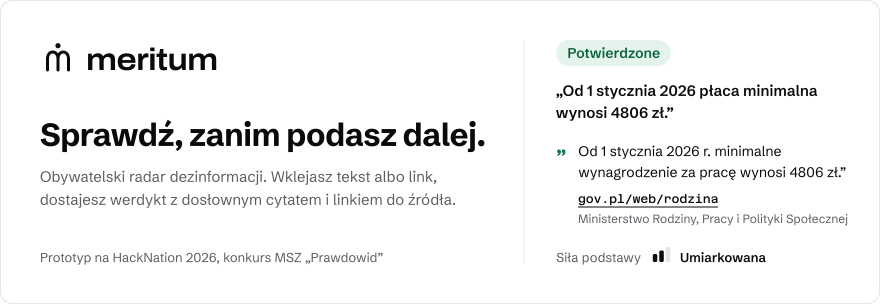
  </picture>

Meritum pomaga sprawdzić pogłoskę albo informację z sieci. Wklejasz tekst lub link i dostajesz ocenę każdego twierdzenia razem z cytatami ze źródeł, na których się opiera. Narzędzie jest dla każdego obywatela, także dla osób, które rzadko korzystają z internetu.

To prototyp przygotowany na hackathon HackNation 2026 w konkursie MSZ „Prawdowid”. Można go wypróbować pod adresem [meritum.gburek.app](https://meritum.gburek.app), bez konta.

  <picture>
    <source media="(prefers-color-scheme: dark)" srcset="assets/ekran-wynik-dark.webp">
    <source media="(prefers-color-scheme: light)" srcset="assets/ekran-wynik-light.webp">
    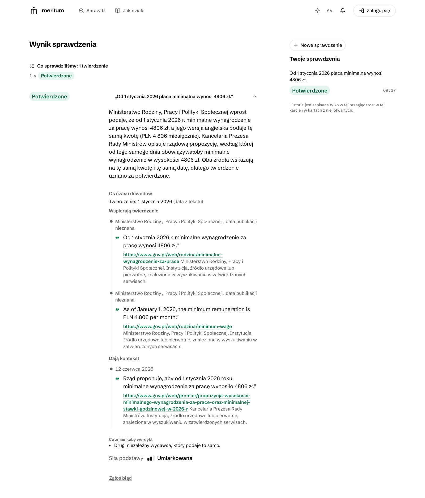
  </picture>
   
  Wynik prawdziwego sprawdzenia w środowisku dev, 22 listopada 2026.

## Po co

Pogłoska trafia do człowieka w feedzie albo w wiadomości od znajomych. Sprostowanie często już istnieje, tylko gdzie indziej: w serwisie fact-checkingowym, w komunikacie urzędu, w akcie prawnym. Czat AI odpowie płynnie i pewnie, ale odpowiedzi bez źródła nie da się sprawdzić.

## Co działa dziś

To samo pytanie można zadać czterema drogami i każda prowadzi do tego samego API, więc wynik jest ten sam:

- formularz na stronie WWW, który przyjmuje tekst, link, nagranie głosowe i zrzut ekranu,
- aplikacja Discord z komendą `/sprawdz`,
- wtyczka do Chrome, która dodaje przycisk „Sprawdź” pod postami,
- konektor MCP dla aplikacji czatu AI.

Piąty kanał, SMS, działa tylko w środowisku dev, przez telefon z Androidem i aplikację SMS Gateway for Android.

Strona ma motyw jasny, ciemny i ciemny o wysokim kontraście oraz cztery rozmiary tekstu. Sprawę nierozstrzygniętą albo sporną można przekazać moderatorom, którzy mają własny panel.

## Jak działa sprawdzenie

  <picture>
    <source media="(prefers-color-scheme: dark)" srcset="assets/droga-sprawdzenia-dark.svg">
    <source media="(prefers-color-scheme: light)" srcset="assets/droga-sprawdzenia-light.svg">
    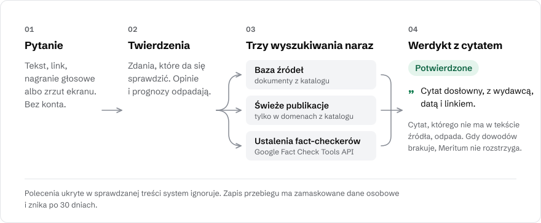
  </picture>

1. Wysyłasz tekst, link, nagranie głosowe albo zrzut ekranu.
2. System wyodrębnia twierdzenia, które da się sprawdzić, i oddziela je od opinii.
3. Trzy wyszukiwania biegną równolegle: w bazie dokumentów zebranych wcześniej ze źródeł z katalogu, w świeżych publikacjach z tych samych domen i wśród ocen fact-checkerów z Google Fact Check Tools API.
4. Każde twierdzenie dostaje jeden z pięciu werdyktów: potwierdzone, fałszywe, wprowadzające w błąd, brak wystarczających dowodów albo nie podlega weryfikacji.
5. Pod werdyktem są cytaty z wydawcą, datą i linkiem. Cytat, którego nie ma dosłownie w tekście źródła, system odrzuca.

Katalog źródeł jest jawny i ma 64 wpisy: 54 źródła urzędowe lub pierwotne i 10 wtórnych. Siedem wpisów jest wyłączonych, na przykład dlatego, że serwis zabrania robotom wstępu, więc system korzysta z 57. Każdy wpis ma powód kwalifikacji i licencję albo podstawę prawną.

Obok werdyktu jest siła podstawy. Wynika z jawnych przesłanek: ile niezależnych źródeł potwierdza twierdzenie, ile z nich jest urzędowych, czy są aktualne i zgodne. Gdy dowodów brakuje, Meritum nie rozstrzyga i mówi, czego nie udało się ustalić.

AI pomaga zrozumieć pytanie, przeszukać materiały i napisać odpowiedź prostym językiem. Werdykt wynika z cytatów i przesłanek, które każdy może sprawdzić sam. Polecenia ukryte w sprawdzanej treści system ignoruje i zapisuje jako zdarzenie. Każde sprawdzenie zostawia zapis przebiegu z zamaskowanymi danymi osobowymi, usuwany po 30 dniach.

## Jak to wygląda

Wszystkie zrzuty pochodzą ze środowiska dev z 22 listopada 2026 i pokazują prawdziwe sprawdzenia.

<table>
  <tr>
    <td width="50%" valign="top">
      <picture>
        <source media="(prefers-color-scheme: dark)" srcset="assets/ekran-start-dark.webp">
        <source media="(prefers-color-scheme: light)" srcset="assets/ekran-start-light.webp">
        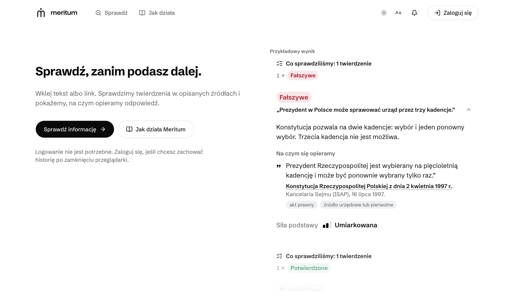
      </picture>
       Strona główna
    </td>
    <td width="50%" valign="top">
      <picture>
        <source media="(prefers-color-scheme: dark)" srcset="assets/ekran-sprawdz-dark.webp">
        <source media="(prefers-color-scheme: light)" srcset="assets/ekran-sprawdz-light.webp">
        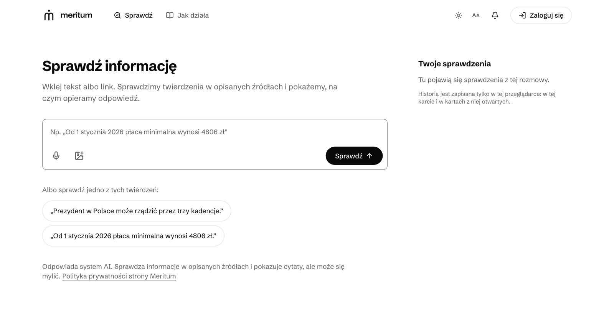
      </picture>
       Formularz, adres <code>/sprawdz</code>
    </td>
  </tr>
  <tr>
    <td valign="top">
      <picture>
        <source media="(prefers-color-scheme: dark)" srcset="assets/ekran-postep-dark.webp">
        <source media="(prefers-color-scheme: light)" srcset="assets/ekran-postep-light.webp">
        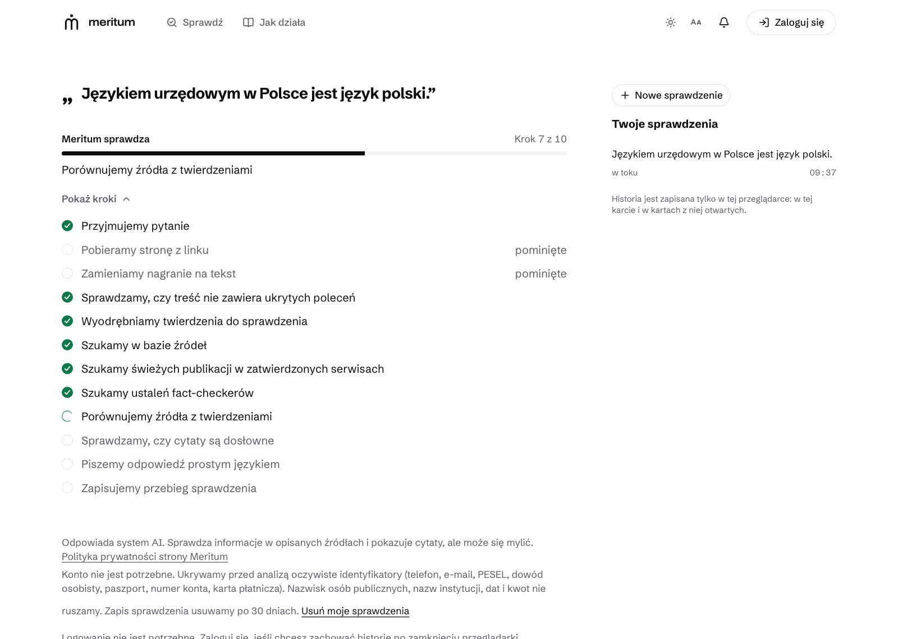
      </picture>
       Sprawdzenie w toku z rozwiniętą listą kroków
    </td>
    <td valign="top">
      <picture>
        <source media="(prefers-color-scheme: dark)" srcset="assets/ekran-jak-dziala-dark.webp">
        <source media="(prefers-color-scheme: light)" srcset="assets/ekran-jak-dziala-light.webp">
        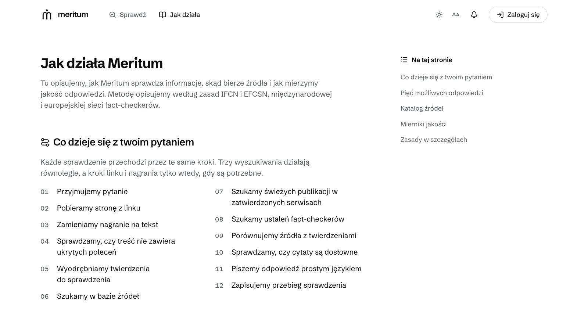
      </picture>
       „Jak działa”: metoda, werdykty i katalog źródeł
    </td>
  </tr>
  <tr>
    <td valign="top">
      <picture>
        <source media="(prefers-color-scheme: dark)" srcset="assets/ekran-wynik-falszywe-dark.webp">
        <source media="(prefers-color-scheme: light)" srcset="assets/ekran-wynik-falszywe-light.webp">
        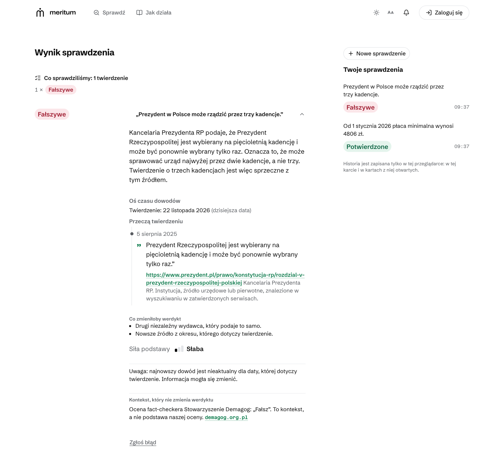
      </picture>
       Werdykt „Fałszywe” z oceną fact-checkera jako kontekstem
    </td>
    <td valign="top">
      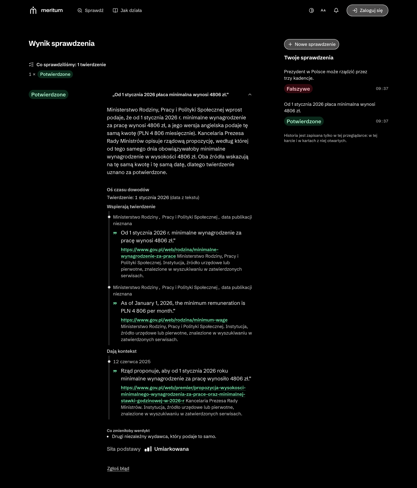
       Motyw ciemny o wysokim kontraście
    </td>
  </tr>
  <tr>
    <td valign="top">
      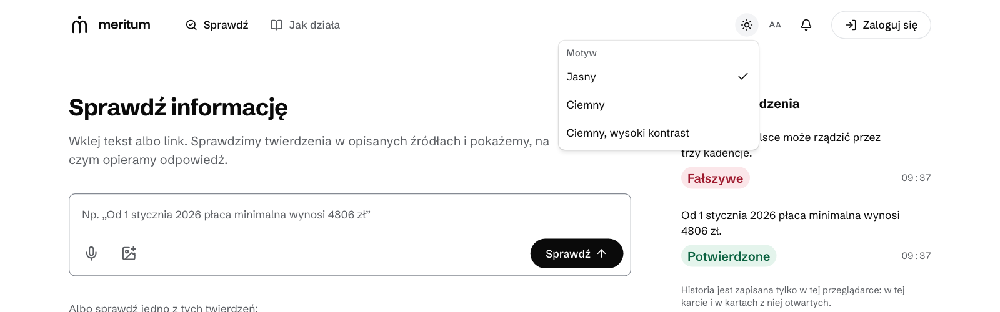
       Wybór motywu w belce
    </td>
    <td valign="top">
      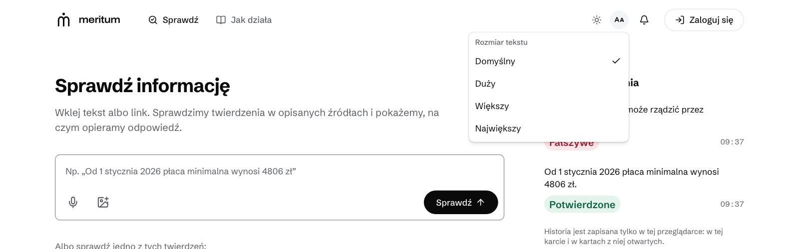
       Wybór rozmiaru tekstu
    </td>
  </tr>
</table>

## Co można wypróbować

| Co | Adres |
|---|---|
| Aplikacja webowa | [meritum.gburek.app](https://meritum.gburek.app) |
| Wersja rozwojowa aplikacji | [meritum-dev.gburek.app](https://meritum-dev.gburek.app) |
| Makieta Discorda, bez konta | [meritum-discord.gburek.app](https://meritum-discord.gburek.app) |
| Aplikacja Discord z komendą `/sprawdz` | [zainstaluj „Meritum”](https://discord.com/oauth2/authorize?client_id=1573692006398693396) |
| Dokumentacja API | [meritum.gburek.app/api/docs](https://meritum.gburek.app/api/docs) |
| Materiały: prezentacje, film, wyliczenia | [meritum-static.gburek.app](https://meritum-static.gburek.app/) |

Wśród materiałów są [prezentacja w PDF](https://meritum-static.gburek.app/pitch/meritum-own.pdf), [arkusz z wynikami ewaluacji i wyliczeniem kosztów](https://meritum-static.gburek.app/meritum-koszty-i-wyniki.xlsx), [dodatek z pełnym diagramem kontenerów](https://meritum-static.gburek.app/dodatek.html) i trzy wersje krótkiego filmu: [„Zanim podasz dalej”](https://meritum-static.gburek.app/film/meritum-film-a.mp4), [„Jedno zdanie”](https://meritum-static.gburek.app/film/meritum-film-b.mp4) i [„Manifest”](https://meritum-static.gburek.app/film/meritum-film-c.mp4).

Do pokazu wtyczki służą makiety platform z fikcyjnymi danymi: [X](https://meritum-x.gburek.app), [Facebook](https://meritum-facebook.gburek.app), [Instagram](https://meritum-instagram.gburek.app), [Reddit](https://meritum-reddit.gburek.app) i [TikTok](https://meritum-tiktok.gburek.app). Paczka wtyczki jest w prywatnym repozytorium, więc na razie pobiorą ją tylko członkowie organizacji. Konektor MCP wymaga klucza, który wydaje zespół.

## Stan prac

Odświeżony wygląd strony jest od 22 listopada 2026 w obu środowiskach. Tego dnia oba odpowiadały poprawnie na zapytanie o stan usługi.

Jakość mierzymy własnym skryptem na zestawie 64 twierdzeń z oczekiwanymi werdyktami. Ostatni zapisany przebieg (7b, 22 listopada 2026) dał:

| Miernik | Wynik |
|---|---|
| Trafność werdyktu | 53 z 64 (83%) |
| Macro-F1 liczone jak w raporcie | 0,82 |
| Macro-F1 ścisłe, tylko z etykiet, które system naprawdę zwrócił | 0,65 |
| Rozstrzygnięte twierdzenia z cytatem | 90% |
| Cytaty uznane za poprawne przez model-sędziego | 83% |
| Wstrzymanie się, gdy dowodów nie ma | 100% |
| Mediana czasu odpowiedzi | 50 s |

Cele z zadania konkursowego to macro-F1 co najmniej 0,75 i mediana czasu do 30 s. Odporności na polecenia ukryte w treści ten przebieg nie mierzył. Zestaw jest mały i służył też do strojenia, więc liczby mówią o postępie prac, a o jakości na nowych pytaniach mniej.

Model kosztuje około 0,0013 USD za sprawdzenie (pomiar na zapisach sprawdzeń z dev, 22 listopada 2026). Szacunek dla większego ruchu, razem z hostingiem, jest w arkuszu z materiałów.

## Jak to jest zbudowane

  <picture>
    <source media="(prefers-color-scheme: dark)" srcset="assets/architektura-dark.svg">
    <source media="(prefers-color-scheme: light)" srcset="assets/architektura-light.svg">
    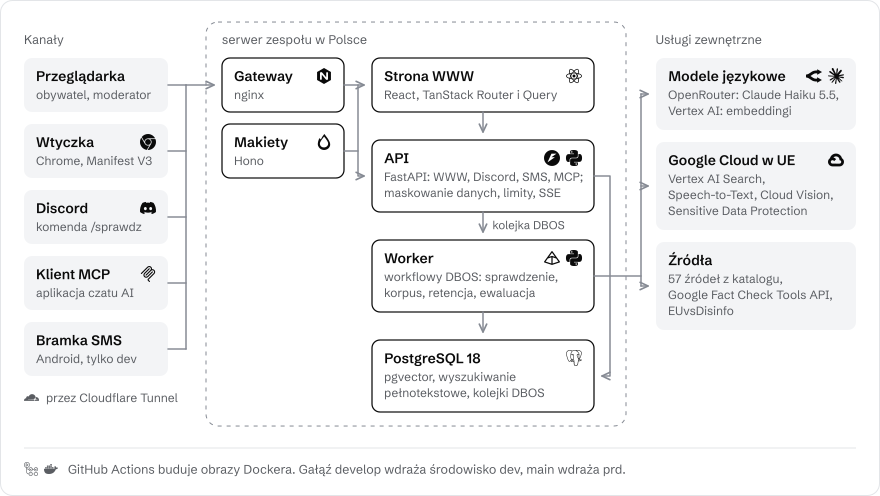
  </picture>

Kanały wysyłają zapytanie do API w FastAPI. API maskuje dane osobowe i zleca sprawdzenie workerowi, który wykonuje je krok po kroku jako trwały workflow DBOS na PostgreSQL z pgvector. Aplikacja webowa to React z TanStack Router i Query, shadcn/ui i Tailwind CSS v4. Konektor MCP działa na FastMCP, a wywołania modelu idą przez Pydantic AI.

Model językowy i dostawcę wyszukiwania wybiera konfiguracja. Dziś jest to Claude Haiku 5.5 przez OpenRouter i Vertex AI Search ograniczony do domen z katalogu. Demo działa na serwerze zespołu w Polsce, za Cloudflare.

Logotypy technologii na schemacie pochodzą z Simple Icons (CC0) i należą do swoich właścicieli.

## Repozytoria

Kod jest na razie prywatny. Po zakończeniu prac chcemy go upublicznić razem z instrukcją uruchomienia jednym poleceniem `docker compose up`.

| Repozytorium | Zawartość |
|---|---|
| meritum-monorepo | punkt startowy: łączy pozostałe repozytoria i uruchamia całość lokalnie |
| meritum-core | kontrakty danych, reguły werdyktu, katalog źródeł |
| meritum-backend | API i kanały: WWW, Discord, SMS, MCP |
| meritum-worker | workflow sprawdzenia, zasilanie korpusu, ewaluacja |
| meritum-frontend | aplikacja webowa i panel moderatorów |
| meritum-extension | wtyczka do przeglądarki |
| meritum-mocks | makiety platform i makieta Discorda |
| meritum-design-system | dokument produktowy, system projektowy, teksty interfejsu |
| meritum-docs | dokumentacja |
| meritum-infra | runnery CI i platforma na serwerze zespołu |
| meritum-marketing | prezentacje, film i opis do zgłoszenia |

Projekt nie ma partnerstw z instytucjami organizującymi konkurs.

## English summary

Meritum is a prototype built for HackNation 2026, in the "Prawdowid" challenge run by the Polish Ministry of Foreign Affairs. A citizen pastes a text or a link, or sends a voice recording or a screenshot, and gets a verdict for each checkable claim: confirmed, false, misleading, insufficient evidence, or not verifiable. Every verdict comes with verbatim quotes from the sources, each with its publisher, date and link, and a quote that does not appear in the source text is rejected. When the evidence is missing, Meritum says what it could not establish.

The web form, the Discord app, a Chrome extension and an MCP connector all call the same API. SMS works in the development environment only. On the latest recorded benchmark run (22 November 2026, 64 claims) the verdict was right in 53 cases and the median response took 50 seconds. The code is private for now. The public demo runs at [meritum.gburek.app](https://meritum.gburek.app), and the pitch deck, three cuts of a short film and the cost workbook are at [meritum-static.gburek.app](https://meritum-static.gburek.app/).
